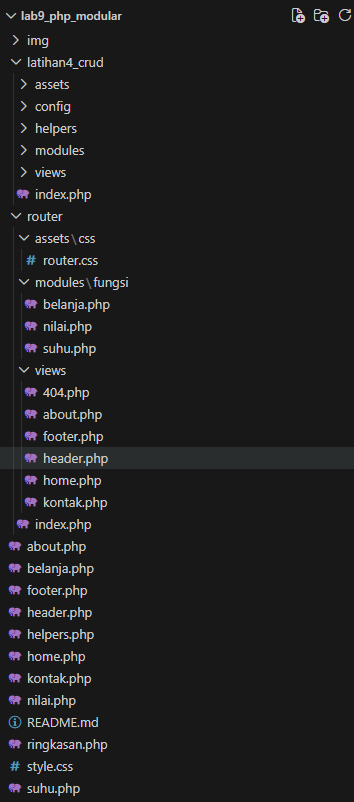
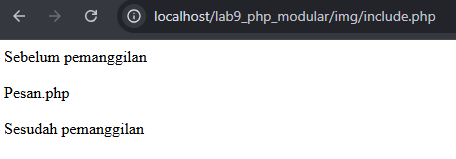

# Praktikum 9 - PHP Modular
## Nama: Fadhil Syafiq Abdullah
## NIM: 312510161
## Kelas: I251B
## Mata Kuliah: Pemrograman Web

### Tujuan Praktikum
1. Menjelaskan pengertian, tujuan, dan manfaat modularisasi program.
2. Membedakan include, require, include_once, dan require_once.
3. Membuat template halaman yang digunakan bersama oleh beberapa halaman.
4. Membuat dan menggunakan function PHP dengan parameter dan nilai kembalian.
5. Menyusun struktur direktori aplikasi PHP secara modular.
6. Menerapkan routing berdasarkan parameter URL dengan validasi halaman.
7. Mengintegrasikan modularisasi dan routing ke aplikasi database dari praktikum sebelumnya.

### Kebutuhan Perangkat
- Web server lokal: XAMPP (Apache + MySQL)
- PHP 8.x
- Browser
- Visual Studio Code (Teks Editor)
- Git

### Cara Menjalankan
1. Salin folder repository ke `C:\xampp\htdocs\`.
2. Jalankan Apache dan MySQL melalui XAMPP Control Panel.
Buka di browser:
    - Latihan 1 dan 2: http://localhost/lab9_php_modular/home.php
    - Latihan 3 (router): http://localhost/lab9_php_modular/router/index.php
    - Latihan 4 (CRUD): http://localhost/Lab9Web/latihan4_crud/index.php
4. Untuk Latihan 4, pastikan database `latihan1` dan tabel `data_barang` dari Praktikum 8 sudah ada.

### Struktur Direktori

### Praktik: Menguji include dan require
buat `pesan.php` dan `uji-include.php`, ubah nama `pesan.php` sementara, lalu amati pesan error dan apakah baris setelah pemanggilan tetap dijalankan. Ulangi dengan `require`.

Hasil Pengamatan:

| Konstruksi | Jika file tidak ditemukan | Baris setelah Pemanggilan |
| :--- | :---: | ---: |
| `include` | Warning | Tetap dijalankan |
| `require` | Fatal error | Tidak dijalankan |

Output `include`:

### Latihan1 - Template Multi-halaman
Buat aplikasi dengan halaman Home, Profil, dan Kontak. Ketiganya harus menggunakan header dan footer yang sama.

File: `header.php`, `footer.php`, `style.css`, `home.php`, `about.php`, `kontak.php`

Output:
Halaman Home:

Halaman Tentang:

Halaman Kontak:

Analisis hasil:
1. Bagian mana yang digunakan bersama oleh semua halaman? Header (judul dan navigasi) dan footer.
2. Apa yang terjadi jika teks navigasi diubah pada `header.php`? Perubahan langsung terlihat di semua halaman yang memuat header tersebut.
3. Mengapa konten halaman tidak diletakkan seluruhnya di `header.php`? Header hanya untuk bagian yang sama di semua halaman. Konten tiap halaman berbeda, jadi harus ada di file masing-masing.
4. Apa manfaat `require_once` dibanding menyalin kode header ke setiap halaman? Tidak ada kode berulang, perawatan lebih mudah, dan file hanya dimuat satu kali.

### Latihan2 - Function
1. Buat function `konversiCelciusKeFahrenheit($c)` yang mengembalikan hasil konversi.
2. Buat function `tentukanStatusNilai($nilai)` yang mengembalikan predikat berdasarkan rentang nilai.
3. Buat function `hitungTotal($harga, $jumlah)` yang mengembalikan total belanja.
4. Pindahkan seluruh function ke `helpers.php` dan panggil dari minimal dua halaman berbeda.

| Nilai | Predikat |
| :--- | ---: |
| 85-100 | A (Sangat Baik) |
| 70-84 | B (Baik) |
| 60-69 | C (Cukup) |
| 50-59 | D (Kurang) |
| 0-49 | E (Sangat Kurang) |

File: `helpers.php`, `suhu.php`, `nilai.php`, `belanja.php`, `fungsi.php`

Output:
Konversi suhu (contoh: 37°C):

Status nilai (contoh: 78):

Total belanja (contoh: 15000 × 3):

Ringkasan pemanggilan semua function:

### Latihan3 - Router Aman
Kembangkan router dengan minimal lima rute. Tambahkan halaman 404 dan pastikan input URL tidak digunakan langsung sebagai path file.

Rute valid dapat diakses, rute tidak dikenal menghasilkan status 404, dan struktur kode mudah dibaca.

Daftar rute:
| Rute	| File	| Keterangan |
| :--- | :---: | ---: |
| `home` (default) |	`views/home.php`	| Halaman beranda |
|`about`	| `views/about.php`	| Tentang aplikasi |
| `kontak`	| `views/kontak.php`	| Kontak |
| `fungsi/suhu`	| `modules/fungsi/suhu.php` | 	Konversi suhu |
| `fungsi/nilai`	| `modules/fungsi/nilai.php` | 	Status nilai |
| `fungsi/belanja`	| `modules/fungsi/belanja.php`	| Total belanja |
| (lainnya) |	`views/404.php`	| Status 404 |

Pengujian dan output:
|Pengujian	| URL	| Hasil |
| :--- | :---: | ---: |
| Rute default |	`index.php`	| Home tampil
| Rute valid	| `index.php?page=fungsi/suhu`	| Form suhu tampil |
| Tidak terdaftar	| `index.php?page=admin/rahasia` |	404 |
| Kosong |	`index.php?page=` |	404 |
| Bukan string |	`index.php?page[]=x` |	 404 |
| Path traversal	| `index.php?page=../helpers` |	404 |

Rute valid:

Halaman 404:

### Latihan4 - Refactoring CRUD
Refactor aplikasi CRUD dari praktikum sebelumnya mengikuti struktur direktori pada bagian F. Semua halaman harus menggunakan template bersama dan dapat diakses melalui router.

Operasi CRUD tetap berjalan, koneksi database hanya dikelola pada satu file konfigurasi, dan tautan antarhalaman menggunakan routing.

Pemetaan file dari praktikum 8:
| Praktikum 8 |	Praktikum 9 |
| :--- | ---: |
| `koneksi.php` |	`config/database.php` |
| `index.php` |	`modules/barang/list.php` |
| `tambah.php` |	`modules/barang/add.php` |
| `ubah.php` |	`modules/barang/edit.php` |
| `hapus.php` |	`modules/barang/delete.php` |
| `style.css` |	`assets/css/style.css` |
| (baru) |	`index.php` (router), `helpers/functions.php`, `views/` |

Daftar rute:

| Rute |	Keterangan |
| :--- | ---: |
| `dashboard` (default)	| Ringkasan data |
| `barang/list`	| Daftar barang |
| `barang/add`	| Tambah barang |
| `barang/edit&id=N` |	Ubah barang |
| `barang/delete` | Hapus barang (POST + CSRF) |
| (lainnya) |	404 |

Output:
Dashboard:

Daftar barang:

Tambah barang:

Hapus barang (sebelum dan sesudah):

Sebelum:

Sesudah:

Halaman 404:

### Kendala dan Cara Mengatasinya

| Kendala |	Penyebab	| Solusi |
| :--- | :---: | ---: |
| `Failed opening required ... header.php`	| File tidak berada di folder `views/` karena struktur folder tidak utuh	| Susun ulang folder sesuai struktur, atau ekstrak zip agar folder terbentuk utuh |
| CSS tidak tampil	| Path `style.css` salah	| Periksa path CSS dan lokasi file lewat DevTools (tab Network) |
| Header dan footer tampil ganda	| File konten masih memanggil header/footer, padahal sudah dimuat router	| Hapus `require` header/footer dari file konten |